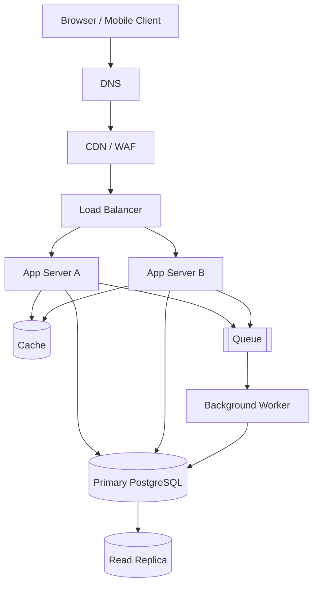

# QuickNotes System Architecture

## Scope and assumptions

This is a planning estimate for a service with **1,000,000 registered users**. It assumes 100,000 daily active users (10% of registered users), each active user loads 20 note-list pages and creates 2 notes per day. Traffic is averaged over 24 hours; real peak traffic may be 5–10 times the average. Average stored note text and metadata are estimated at 2 KB per note, excluding backups and indexes.

## Functional requirements

- Register and authenticate users securely.
- Create, read, update, and delete notes belonging to the authenticated user.
- Assign tags and filter/search a user's notes.
- Paginate results and provide consistent validation/error responses.
- Support account-level data isolation and account deletion.

## Non-functional requirements

- Target 99.9% monthly availability for the API.
- Target p95 read latency below 300 ms under normal load.
- Encrypt traffic with TLS and protect stored credentials using a modern password hash.
- Scale app servers horizontally and keep application instances stateless.
- Monitor latency, errors, saturation, queue lag, and database health.
- Back up the database and test restoration; define explicit RPO/RTO targets before production.

## Load and storage estimates

Assumptions: 100,000 daily active users; 20 reads/user/day; 2 writes/user/day; 2 KB average per stored note; 365 days/year.

| Metric | Calculation | Estimate |
|---|---|---:|
| Reads per day | 100,000 × 20 | 2,000,000 |
| Average reads per second | 2,000,000 ÷ 86,400 | about 23.1 reads/s |
| Writes per day | 100,000 × 2 | 200,000 |
| Average writes per second | 200,000 ÷ 86,400 | about 2.3 writes/s |
| New notes per year | 200,000 × 365 | 73,000,000 |
| Raw note storage per year | 73,000,000 × 2 KB | about 146 GB/year |

The 146 GB/year estimate covers note payloads only. Database indexes, row overhead, tags, user records, replicas, backups, and retained deleted data add storage. Planning should provision additional headroom (for example, 2–3× raw data) and use measured production telemetry to revise assumptions. A 5–10× peak factor implies roughly 115–230 reads/s and 12–23 writes/s at peak under this workload model.

## Architecture diagram

## Components and the problems they solve

- **Client:** Provides the user interface and sends HTTPS requests without owning database credentials.
- **DNS:** Resolves the service hostname to the public entry point and supports controlled endpoint changes.
- **CDN/WAF:** Caches eligible static assets near users and filters common malicious traffic before it reaches the application.
- **Load balancer:** Distributes requests across healthy app servers and removes unhealthy instances from rotation.
- **App Server A and B:** Run identical stateless API code so capacity can increase horizontally and one instance can fail without taking down the service.
- **Cache:** Stores short-lived, frequently requested data to reduce repeated database work; ownership-sensitive cache keys must include the user identity.
- **Primary PostgreSQL database:** Provides durable transactional writes and relational integrity for notes, users, tags, and mappings.
- **Read replica:** Serves eligible read-heavy queries and can reduce pressure on the primary; replication lag means some reads may briefly be stale.
- **Queue:** Buffers asynchronous jobs such as notifications, exports, or search indexing so slow downstream work does not block API responses.
- **Background worker:** Processes queued jobs with retries and idempotency so transient failures do not require the user to resubmit a note.

## GET /notes request flow

1. The client sends `GET /api/v1/notes?page=1&limit=20` over HTTPS with its access token.
2. DNS resolves the API hostname; the CDN/WAF applies edge security rules and forwards the dynamic API request.
3. The load balancer selects a healthy app server.
4. The app server validates the token, derives the user ID, validates pagination, and checks a user-scoped cache key.
5. On a cache miss, the app queries the read replica when suitable, otherwise the primary, filtering by the authenticated user's ID and using the indexed sort order.
6. The server serializes the result and pagination metadata, returns `200 OK`, and caches the result briefly where appropriate.
7. Cache invalidation or versioned keys prevent old note lists from remaining visible indefinitely after writes.

## POST /notes request flow

1. The client sends `POST /api/v1/notes` with an access token and JSON containing `title` and optional `body`.
2. DNS, CDN/WAF, and the load balancer route the request to a healthy app server.
3. The app validates authentication, title length, request size, and ownership-related rules; the user ID comes from the token, not the request body.
4. The app inserts the note into the primary database using a parameterized query and commits the transaction.
5. The app invalidates or updates affected user-scoped cache entries and may enqueue non-critical follow-up work.
6. The API returns `201 Created` with the created note. A worker processes asynchronous jobs independently and retries transient failures safely.

## Trade-offs and resilience

1. **Cache vs. consistency:** Caching reduces read latency and database load, but can return stale data. Use short TTLs, user-scoped keys, write-through or invalidation after mutations, and bypass cache for operations requiring read-after-write consistency.
2. **Read replica vs. consistency and cost:** A replica scales reads but adds infrastructure cost and replication lag. Route writes to the primary, route only suitable reads to replicas, monitor lag, and send read-after-write requests to the primary when necessary.
3. **Synchronous work vs. queue:** Queues isolate slow notifications or exports from user-facing latency, but add operational complexity and eventual consistency. Use durable messages, retries with backoff, dead-letter handling, and idempotent workers.
4. **SQL vs. horizontal write scaling:** PostgreSQL gives strong relational constraints and transactions but a single primary can become a write bottleneck. Start with a managed, highly available primary and read replica; partition large tables when evidence supports it, and evaluate sharding only when measured limits require it.

## Avoiding single points of failure

Run at least two app instances across separate failure domains and use health checks behind a redundant managed load balancer. Use managed PostgreSQL with automated backups, point-in-time recovery, multi-zone standby/failover, and a tested recovery runbook; a read replica alone is not a complete backup. Deploy the cache and queue in highly available configurations, keep durable data in the database, and ensure the service degrades gracefully if optional caching or asynchronous jobs are unavailable. DNS, certificates, secrets, monitoring, and deployment pipelines also need documented ownership and recovery procedures.
